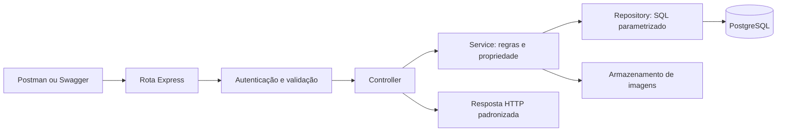

# Guia técnico para a apresentação

## O caminho de uma requisição

A rota define a operação. O middleware identifica o usuário e valida o token. O controller traduz a chamada HTTP. O service decide o que pode acontecer. O repository acessa o banco com parâmetros separados do texto SQL.

`app.js` monta o Express e recebe banco/configuração, o que permite testar a aplicação com recursos isolados. `server.js` carrega as variáveis de ambiente, conecta ao PostgreSQL e abre a porta HTTP.

## Autenticação e autorização

**Autenticação** responde “quem está fazendo a requisição?”. O login verifica a senha com bcrypt e emite um JWT assinado com HS256, validade configurável, issuer `fitinity-api` e audience `fitinity-community`. O token contém a identificação do usuário; não é um lugar para colocar senha ou dados sensíveis.

**Autorização** responde “essa pessoa pode alterar este recurso?”. Depois de autenticar, o serviço compara o autor da publicação ou do comentário com o usuário do token. Por isso um token válido de B não permite alterar conteúdo de A.

Exemplo para explicar: “O cadastro cria o usuário, o login fornece o token, o middleware valida o token e o serviço verifica se o recurso pertence a quem está tentando alterá-lo.”

O JWT é assinado, não criptografado. Nesta atividade não há refresh token nem logout com revogação centralizada. O acesso termina pela expiração do token ou por sua remoção no cliente. O cliente precisa guardar o token com cuidado.

## Senhas e e-mails

A senha nunca é salva em texto puro. O bcrypt usa salt próprio e um custo configurável. O login compara a senha enviada com o hash; não recupera a senha original. A validação aceita pelo menos oito caracteres e no máximo 72 bytes UTF-8, respeitando o limite do bcrypt.

O e-mail é normalizado e tem restrição UNIQUE. A verificação do banco evita duplicidade mesmo diante de requisições concorrentes. O perfil e as demais respostas não incluem `password_hash`.

## Publicações e comentários

O `user_id` vem da autenticação. O cliente não pode escolher outra pessoa como autor. Cada publicação pertence a um usuário e pode receber várias curtidas e comentários.

Editar e excluir comentários próprios são requisitos do PDF. As rotas PATCH e DELETE de `/api/comments/:id` foram acrescentadas porque a tabela sugerida não as enumerava.

A exclusão de uma publicação remove comentários e curtidas por cascata no banco. As imagens são gerenciadas no serviço, pois arquivos em disco não participam das transações do PostgreSQL.

## Uploads

O Multer recebe o multipart e limita a quantidade e o tamanho dos arquivos. O arquivo é validado antes de ser salvo: extensão, MIME declarado, assinatura detectada e decodificação. JPEG, PNG e WebP são aceitos; o limite definido é 5 MB, até 16 megapixels e sem animação.

Verificar só a extensão seria insuficiente: um texto pode ser renomeado para `.png`. A decodificação reduz a chance de aceitar conteúdo que apenas imita o cabeçalho de uma imagem.

O nome final é gerado pela aplicação. O banco armazena um caminho `/uploads/...`. Na substituição, o novo arquivo é salvo e a referência é atualizada; o anterior é removido depois. Se a atualização falha, o novo arquivo deve ser limpo.

Arquivo e banco não formam uma transação única. Uma interrupção abrupta ou falha do sistema de arquivos ainda pode exigir reconciliação manual. A rotina cobre os erros tratados durante as requisições, mas não promete atomicidade entre disco e banco.

## Curtidas e integridade

A restrição `UNIQUE(user_id, post_id)` impede duplicar curtidas. Repetir POST de curtida retorna a curtida existente. Remover a própria curtida é idempotente enquanto a publicação existir.

As chaves estrangeiras impedem comentários ou curtidas ligados a usuários/publicações inexistentes. CHECK, NOT NULL e UNIQUE reforçam as regras além da camada HTTP.

O repository usa SQL parametrizado. Por exemplo, o valor do e-mail é enviado como parâmetro `$1`, e não concatenado ao comando.

## Respostas e testes

Sucessos com conteúdo usam `data`; erros usam `error.code` e `error.message`. 401 indica falha de autenticação, 403 indica falta de permissão e 404 indica recurso inexistente. 204 não leva corpo.

Os testes automatizados passam pelo HTTP, pelo serviço e por um PostgreSQL real. Usar dois usuários demonstra autorização. Os testes de imagens também verificam acesso e limpeza de arquivos. A coleção do Postman permite reproduzir a demonstração manualmente.

Antes da apresentação, cada integrante deve executar um fluxo completo e conseguir explicar onde ficam as regras. Consulte [validação](validacao.md) para os resultados efetivamente obtidos.

## Perguntas para ensaiar

- Por que guardar hash em vez de senha? Como o bcrypt verifica o login?
- Qual a diferença entre token válido e permissão para editar uma publicação?
- Por que a autoria não pode vir do corpo enviado pelo cliente?
- O que impede duas curtidas iguais, inclusive sob concorrência?
- Por que verificar extensão, MIME e conteúdo do arquivo?
- O que acontece com comentários, curtidas e imagem ao excluir uma publicação?
- Como instalar, configurar e executar em outra máquina?
- Quais decisões foram do grupo e quais eram exigências do professor?

## Limites conhecidos

O protótipo do Figma não foi inspecionado. A aplicação usa imagens em disco local e um único servidor; múltiplas instâncias exigiriam armazenamento compartilhado. Não há frontend, recuperação de senha, moderação ou deploy exigido. A URL remota do GitHub deve ser adicionada quando a publicação for realizada.
