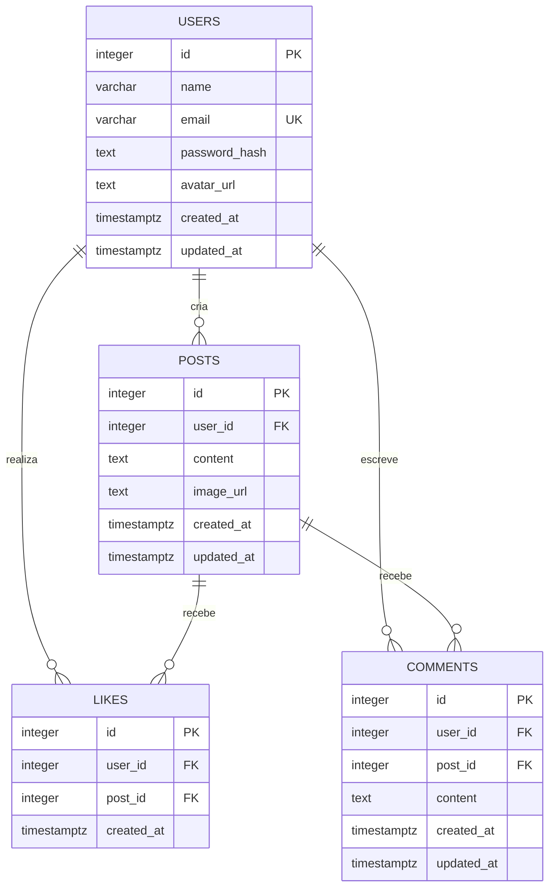

# Modelo de dados

A persistência usa PostgreSQL. Os identificadores são inteiros positivos gerados por identity. Datas são `TIMESTAMPTZ`, serializadas como datas ISO na API.

## Regras do esquema

| Entidade | Regra |
| --- | --- |
| users | `email` único, normalizado em minúsculas e sem espaços externos; nome entre 2 e 100 caracteres. |
| posts | Autor existente; conteúdo não vazio, até 5000 caracteres; imagem opcional. |
| likes | Restrição `UNIQUE(user_id, post_id)`, além das duas chaves estrangeiras. |
| comments | Usuário e publicação existentes; conteúdo não vazio, até 2000 caracteres. |

As tabelas dependentes têm chaves estrangeiras com `ON DELETE CASCADE`. Excluir uma publicação remove suas curtidas e comentários no banco. O serviço também remove o arquivo de imagem associado. O endpoint de excluir usuário não integra este escopo; não apague usuários diretamente pelo SQL para gerenciar imagens.

O banco guarda o caminho da imagem, não seu conteúdo binário. As imagens ficam no diretório configurado por `UPLOAD_DIR`; a API expõe somente arquivos dessa pasta com nomes gerados pela aplicação.

`password_hash` existe apenas na persistência e na verificação de login. As consultas que constroem as respostas não o incluem.

Os índices atendem à ordenação de publicações por data/id, ao acesso por autor, aos comentários de uma publicação e às curtidas por publicação. O SQL executável está em `database/migrations/001_initial.sql`.

A regra de e-mail e as constraints do banco complementam a validação HTTP. Por exemplo: duas requisições concorrentes de cadastro não podem criar o mesmo e-mail, mesmo se ambas passarem por uma consulta anterior.
